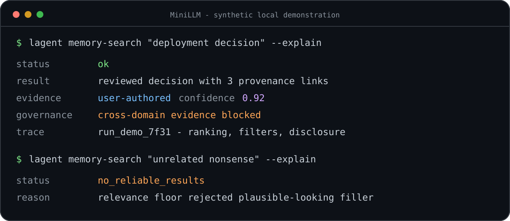
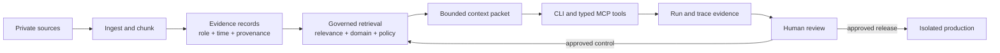

# MiniLLM

[](https://github.com/Dalconzo/MiniLLM/actions/workflows/ci.yml)


**A local-first agent memory and tool runtime built around provenance, explicit
uncertainty, review gates, and observable failure.**



Long-running agents need more than vector search. MiniLLM treats memory as a
governed evidence system: source roles stay visible, weak retrieval can abstain,
cross-domain evidence is filtered, agent feedback remains inert until reviewed,
and production promotion is separated from the builder that proposed a change.

## What this project demonstrates

- **Evidence-aware memory:** ingestion, lexical and semantic retrieval, typed
  memory records, provenance links, temporal handling, contradiction reporting,
  and bounded context packets.
- **Safe failure behavior:** relevance floors, `no_reliable_results`, source
  blocking, disclosure tiers, path containment, secret redaction, and typed MCP
  tools instead of arbitrary shell access.
- **Review-gated learning:** agent feedback is append-only evidence until a
  separately reviewed ranking control reaches an applied state.
- **Isolated delivery:** builder and production identities, check-only deployment
  gates, immutable artifact hashes, explicit human authorization, audit chains,
  smoke tests, and rollback-oriented cutover scripts.
- **Observable operation:** run IDs, stage-level traces, health checks, integrity
  checks, evaluation reports, and regression fixtures make failures inspectable.

## Evidence at a glance

| Claim | Inspectable evidence |
| --- | --- |
| The committed release candidate passes its automated suite | [Verification record](docs/evidence/verification.md) and [`tests/`](tests/) |
| Weak or wrong-domain evidence is not silently promoted | [`tests/test_memory_search.py`](tests/test_memory_search.py), [`tests/test_memory_high_risk.py`](tests/test_memory_high_risk.py) |
| Filesystem and MCP boundaries fail closed | [`tests/test_patches.py`](tests/test_patches.py), [`tests/test_repo_indexer.py`](tests/test_repo_indexer.py), [`tests/test_home_mcp.py`](tests/test_home_mcp.py) |
| Builder output cannot self-authorize production | [`tests/test_deployment_gate.py`](tests/test_deployment_gate.py), [`tests/test_promotion_controller.py`](tests/test_promotion_controller.py), [`tests/test_trusted_promotion.py`](tests/test_trusted_promotion.py) |
| Public fixtures exclude private corpus and browser traces | [Fixture provenance](docs/evidence/public-fixture-provenance.md) and [`scripts/check_public_surface.py`](scripts/check_public_surface.py) |
| Risks and unsupported claims are explicit | [Threat model](docs/security/threat-model.md) and [limitations](#status-and-limitations) |

The evidence boundary is deliberate: tests prove the behavior they exercise,
not formal security certification or the state of a private production host.

## Quick start

Prerequisites: Python 3.11 or newer. `uv` is recommended but not required.

```bash
uv venv
source .venv/bin/activate
uv pip install -e '.[dev]'

pytest -q
lagent --help
```

Run the focused safety and memory gates:

```bash
pytest -q \
  tests/test_memory_privacy.py \
  tests/test_memory_search.py \
  tests/test_repo_indexer.py \
  tests/test_patches.py \
  tests/test_home_mcp.py \
  tests/test_deployment_gate.py \
  tests/test_promotion_controller.py \
  tests/test_trusted_promotion.py
```

The repository ships only synthetic fixtures and empty runtime directories.
Private conversation exports, credentials, logs, indexes, and local service state
are excluded from version control.

## Architecture



The main package lives under [`src/local_agent_lab`](src/local_agent_lab). The
normative security and memory contracts live under
[`mac_mini_llm_consolidated_specs`](mac_mini_llm_consolidated_specs), with
focused runbooks in [`docs/`](docs/).

## Human ownership and AI assistance

David owns problem framing, architecture, constraints, threat models,
evaluations, and acceptance decisions. AI accelerates implementation variants,
test generation, code review, and regression loops. Model output is treated as a
proposal: it does not authorize deployment, silently mutate memory truth, or
count as validation of its own work.

See [AI-assisted development](docs/ai-assisted-development.md) for the concrete
working pattern and evidence boundary.

## Status and limitations

- **Pre-release:** APIs and storage contracts may still change.
- **Local-first:** Ollama is the intended model boundary; model availability and
  quality depend on the operator's local runtime.
- **No bundled private corpus:** a clean checkout demonstrates code and synthetic
  tests, not an operator's private memory database or production host state.
- **No formal certification:** the threat model and adversarial tests document
  controls and residual risk; they are not an external security audit.
- **Platform scope:** core Python behavior is portable, while launchd/service
  identity automation is macOS-specific.

## Project map

- [`src/local_agent_lab/memory/`](src/local_agent_lab/memory/) - ingestion,
  retrieval, ranking, context, feedback, and governance
- [`src/local_agent_lab/home_mcp.py`](src/local_agent_lab/home_mcp.py) - typed,
  allowlisted MCP surface with tracing
- [`src/local_agent_lab/deployment_gate.py`](src/local_agent_lab/deployment_gate.py)
  - check-only candidate policy
- [`src/local_agent_lab/promotion_controller.py`](src/local_agent_lab/promotion_controller.py)
  - reviewed promotion orchestration
- [`tests/`](tests/) - unit, adversarial, integration, and acceptance fixtures
- [`docs/evidence/verification.md`](docs/evidence/verification.md) - reproducible
  release-candidate checks

## Security

Read [SECURITY.md](SECURITY.md) before deployment or vulnerability reporting.
The detailed [threat model](docs/security/threat-model.md) documents trust
boundaries, controls, evidence, and residual risks.
